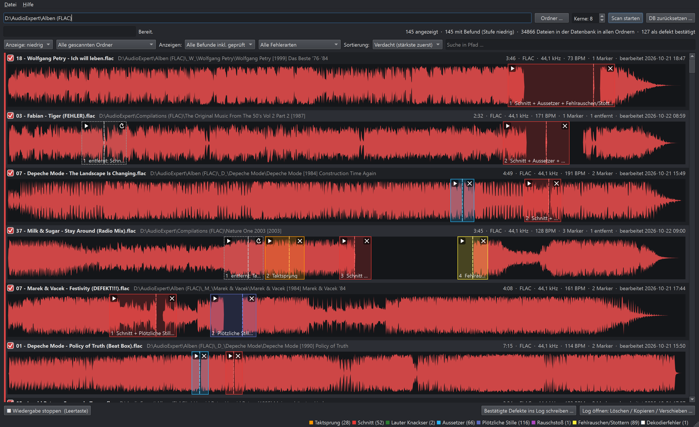
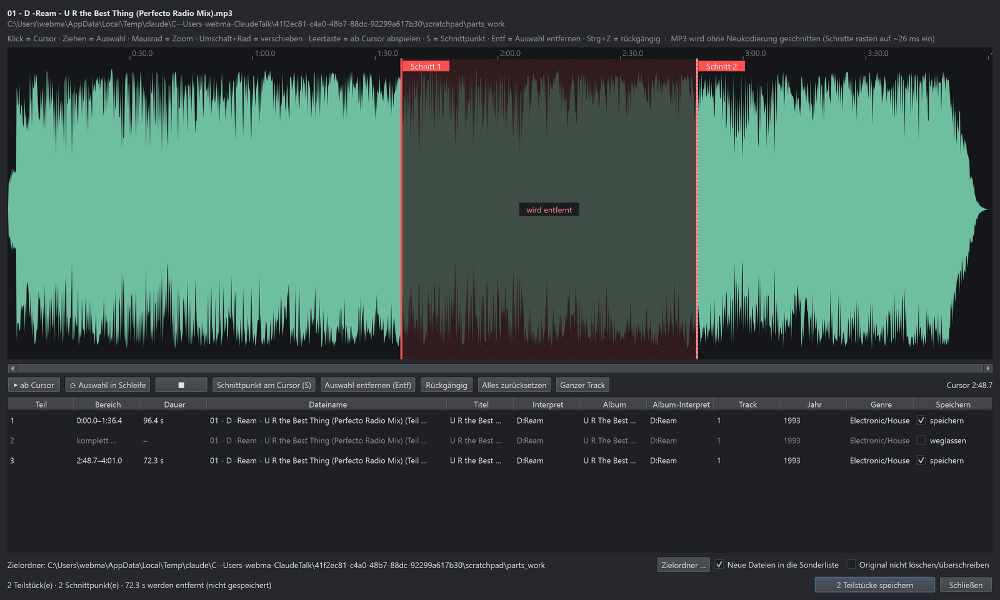

# FlacCheck

Findet Fehler *im Audiomaterial* von FLAC-, MP3- und anderen Audiodateien, die
eine Prüfsummen-Kontrolle nicht findet: Der Track springt intern, hat aber die
richtige Länge, und der fehlerhafte Inhalt ist korrekt in die Prüfsumme eingegangen.

Ganze Ordner werden samt Unterordnern geprüft. Auffällige Tracks erscheinen
untereinander als Wellenform. Jede Fundstelle bekommt einen Marker
(−5 s … +5 s, bei Taktsprüngen −8 s), der sich per Klick in Schleife anhören lässt.



## Installation (Windows)

Den aktuellen Installer **`FlacCheck-<Version>-Setup.exe`** unter
[Releases](https://github.com/Yakobo1970/FlacCheck/releases) herunterladen und starten. Er installiert
pro Benutzer (keine Admin-Rechte nötig) und bringt alles mit – Python, Qt, FFmpeg, libsndfile und
PortAudio müssen nicht separat installiert werden. Die Datenbank liegt in `%LOCALAPPDATA%\FlacCheck`
und bleibt beim Deinstallieren erhalten.

Weil der Installer nicht signiert ist, zeigt Windows SmartScreen beim ersten Start eventuell eine
Warnung („Weitere Informationen“ → „Trotzdem ausführen“).

## Aus dem Quellcode starten

```
FlacCheck.bat
```

Benötigt die Conda-Umgebung `flaccheck` (Python 3.11, siehe `requirements.txt`):

```
conda create -n flaccheck -c conda-forge --override-channels python=3.11
%USERPROFILE%naconda3\envslaccheck\python.exe -m pip install -r requirements.txt
```

## Installer bauen

```
%USERPROFILE%naconda3\envslaccheck\python.exe -m pip install pyinstaller
%USERPROFILE%naconda3\envslaccheck\python.exe -m PyInstaller --noconfirm FlacCheck.spec
copy LICENSE dist\FlacCheck\ & copy THIRD_PARTY_NOTICES.md dist\FlacCheck"C:\Program Files\Inno Setup 7\ISCC.exe" installer\FlacCheck.iss
```

Ergebnis: `dist_installer\FlacCheck-<Version>-Setup.exe`. Prüfen lässt sich die gebaute Anwendung mit
`dist\FlacCheck\FlacCheck.exe --selftest <Audiodatei> <ausgabe.txt>` (Bibliotheken, Analyse im
Worker-Prozess, Tags, deutsche Qt-Texte, Hauptfenster mit eigener Test-Datenbank).

## Bedienung

1. Ordner wählen und **Scan starten**. Bereits geprüfte, unveränderte Dateien werden
   übersprungen. Ein Abbruch ist jederzeit möglich, der nächste Scan setzt fort.
2. **▶ am Marker**: Bereich in Schleife hören. Nochmal klicken oder Leertaste = Stopp.
   **Klick in die Wellenform** (auch in einen Marker): ab dort bis zum Trackende abspielen.
3. Fehler nicht hörbar? **✕** am Marker graut ihn als Fehlalarm aus (↺ holt ihn zurück).
   Fehler bestätigt? **Checkbox** links anhaken.
4. **Bestätigte Defekte ins Log schreiben**: volle Pfade, eine Zeile pro Datei.
5. **Log öffnen**: die Dateien aus dem Log löschen (Papierkorb oder endgültig),
   kopieren oder verschieben, wahlweise mit Ordnerstruktur.

**Anzeige-Stufe (niedrig/mittel/hoch):** Geprüft wird immer in voller Tiefe. Jede
Fundstelle merkt sich, ab welcher Stufe sie gezeigt wird; das Umschalten filtert nur die
Anzeige, ohne neuen Scan. Die **Sortierung „Fehlerart“** gruppiert die Funde
(zuverlässigste Arten zuerst).

**Wellenfarbe:** blass rot = Fund ab Stufe „niedrig“ (wahrscheinlichster Fehler), gelblich =
ab „mittel“, grün = nur auf „hoch“. Die Fußzeile zeigt je Fehlerart Farbe und Anzahl.
Sind Tracks markiert (Strg/Umschalt + Klick oder Cursortasten), leuchten nur sie hell, die übrigen
werden abgedunkelt.

**Mehrere Datenbanken:** Datei → Datenbank öffnen / Neue Datenbank / Datenbank sichern unter.
Die zuletzt geöffnete Datenbank wird beim nächsten Start wieder geladen.

**Sonderliste & Bearbeiten:** Rechtsklick → „In Sonderliste parken“ legt besondere Fälle (z. B.
zu bearbeitende MP3s) beiseite; „Anzeigen: Sonderliste“ bzw. „Alle Listen“ zeigt sie. Rechtsklick →
„Bearbeiten (teilen / schneiden) …“ öffnet ein Bearbeitungsfenster: Schnittpunkte setzen (Track wird
geteilt), Bereiche entfernen, einzelne Teilstücke per Haken in der Spalte „Speichern“ weglassen (z. B. die
Stille vor einem Bonustrack), Dateiname und Tags je Teilstück anpassen (vorbelegt aus dem Original,
Cover und übrige Tags werden übernommen). MP3 wird ohne Neukodierung geschnitten (Frame-genau,
~26 ms), FLAC/WAV/AIFF sample-genau und verlustfrei. Das Original wird nie überschrieben: Es wird in
»(defekt) Name« umbenannt und in den Windows-Papierkorb gelegt (mit „Original nicht löschen/überschreiben“
bleibt es so benannt im Originalordner). Der Zielordner-Dialog zeigt auch die Dateien im Ordner. Die gespeicherten Teile werden sofort neu bewertet; mit „Neue Dateien
in die Sonderliste“ stehen sie danach samt Wellenform in der Sonderliste zum Anhören. Rechtsklick →
„Zur Neubewertung zurückschicken“ analysiert erneut und holt sie aus der Sonderliste.



**Verschobene Dateien:** Wird eine Datei verschoben (auch mit geänderten Tags), erkennt der
nächste Scan ihres neuen Ordners sie an Dateiname, Spieldauer und Abtastrate wieder und übernimmt
Analyse und Prüfstand – ohne Neuanalyse. Einträge ohne neuen Fundort gelten als „fehlend“ und
werden ausgeblendet; „Datei → Fehlende Dateien prüfen …“ kann sie entfernen.
Ausnahme: Eine als defekt bestätigte Datei, die unter gleichem Namen mit anderer Dateigröße an
einem anderen Ort auftaucht (z. B. neu eingelesen), erbt den Defekt nicht und wird frisch analysiert.
Ersetzte Dateien am selben Ort werden ohnehin neu analysiert, ihr Prüfstand wird dabei zurückgesetzt.

**Drag & Drop:** Dateien oder Ordner einfach ins Fenster ziehen – sie werden sofort analysiert
und erscheinen bei ihren Scanquellen.

**Scans addieren sich:** Jeder Scan ergänzt die Datenbank, bereits geprüfte, unveränderte
Dateien werden übersprungen. Jeder gescannte Ordner wird als **Scanquelle** gemerkt.
In den Klapplisten mit Häkchen lassen sich **Scanquellen** und **Fehlerarten** einzeln ein- und
ausblenden; „Alle …“ setzt bzw. entfernt alle Häkchen. Die Auswahl bleibt gespeichert. **DB zurücksetzen …**
löscht alle Ergebnisse samt Prüfstand (vorher ggf. die Defekte ins Log schreiben).

**Ansicht „Fehlerfrei“** (unter „Anzeigen“): von Hand freigegebene Tracks (alle Marker entfernt)
und Tracks ohne Befund, die zuletzt bearbeiteten oben. Entfernte Marker erscheinen grau
gestrichelt und lassen sich per ▶ anhören und per **↺** einzeln zurückholen; der Track steht
dann wieder unter „Offen“. **Rechtsklick → Jetzt neu analysieren** prüft Titel sofort neu
(frische Marker, alte Entfernungen verworfen). **Liste leeren …** entfernt die angezeigten
fehlerfreien Tracks aus der Datenbank – beim nächsten Scan ihres Ordners werden sie neu analysiert.

Rechtsklick auf einen Track bietet weitere Aktionen (alle Marker entfernen,
wiederherstellen, neu analysieren, im Explorer zeigen).

## Erkannte Fehlerarten

| Art | Erkennung |
|---|---|
| Taktsprung | bleibende Stufe in der Lage des Rhythmusrasters (Track springt, Länge stimmt) |
| Fehlrauschen/Stottern | Hochtonpegel flackert extrem und L/R-Korrelation bricht ein (Lesefehler-Müll) |
| Schnitt | Schnittkante neben dem Raster, nach der das Audio wegbricht oder aus der Taktzählung hüpft |
| Lauter Knackser | einmalige Spitze über dem Pegel des ganzen restlichen Tracks, neben dem BPM-Raster |
| Aussetzer | digitale Nullen oder ein vom Laufwerk „eingefrorener“ Signalwert mitten im laufenden Material (klingt wie Stille) |
| Plötzliche Stille | Pegelabsturz mit hartem Ab- und Einsatz |
| Rauschstoß | kurzer breitbandiger Rauschblock |
| Dekodierfehler | kaputte Frames, Datei kürzer als im Header angegeben |

## Empfohlene Arbeitsweise

**Anzeige „niedrig“ + Standardsortierung „Verdacht“.** Gemessen an ~35.000 FLAC-Tracks mit 127
bestätigten Defekten: „niedrig“ zeigt 1.286 Tracks und alle 127 Defekte, „mittel“ (3.054) und
„hoch“ (8.876) keinen zusätzlichen. In der Sortierung liegen 103 Defekte unter den ersten 200 Tracks,
115 unter den ersten 400. Trefferquote je Art auf „niedrig“: Plötzliche Stille ≈ 74 %, Aussetzer ≈ 64 %,
Fehlrauschen/Stottern ≈ 38 %, Schnitt ≈ 8 %, Taktsprung ≈ 2 %.

## Kalibrierung (Stand 0.2.0)

Grundlage: 68 Benchmark-Tracks mit eingefügten Sprüngen, die echten Fehlerfälle
EMF, Wendler und Pink Panther sowie ~260 im Ordner `Alben (FLAC)\_A_` durchgehörte
Fundstellen (4 echte Defekte, Rest Fehlalarme). Ergebnis dort nach Neuanalyse:

| Anzeige | Dateien mit Fund | davon echte Defekte |
|---|---|---|
| niedrig | 12 | 4 |
| mittel | 56 | 4 |
| hoch | 726 | 4 |

Seit 0.7 (kalibriert an 6049 Dateien, 26 bestätigten Defekten und rund 1100 entfernten
Fehlalarmen): **Rauschstoß** zählt nur noch, wenn links und rechts unkorreliert sind
(Lesefehler-Müll statt Riser/Phasing) – 93 % weniger Fehlalarme. **Taktsprung** zählt nur,
wenn er nicht auf einem musikalischen Raster (½, ¼, ⅓ Schlag) landet – 44 % weniger
Fehlalarme. Alle 26 Defekte bleiben sichtbar.

Seit 0.8: **Lauter Knackser** nur noch, wenn die Spitze über den Pegel des gesamten restlichen
Tracks hinausragt und neben dem BPM-Raster liegt – von 229 entfernten Fehlalarmen melden sich
noch 2.

Seit 0.9: **Schnitt** (früher „Knackser/Schnitt“) nur noch, wenn die Schnittkante neben dem
Raster liegt und das Audio danach wegbricht oder aus der Taktzählung hüpft (sehr starke Knackser
zählen immer) – von 229 entfernten Fehlalarmen melden sich noch 28.

Die zuverlässigste Art ist **Fehlrauschen/Stottern**. Taktsprünge um einen halben Schlag
sind fast immer Betonungswechsel zwischen Kick und Offbeat und erscheinen erst auf „hoch“.

## Daten

- Datenbank: `%LOCALAPPDATA%\FlacCheck\flaccheck.db` (Ergebnisse, Marker, Prüfstatus).
  Ca. 8–12 KB je Datei mit Befund (Wellenform-Vorschau), unauffällige Dateien nur wenige hundert Byte –
  auch sehr große Archive sind kein Problem. Wellenformen werden erst beim Anzeigen geladen.
- Logdateien: standardmäßig `Dokumente\FlacCheck\defekte_JJJJ-MM-TT.log`

## Icons

`python scripts/make_icon.py` erzeugt das App-Icon (geprüfte CD), `python scripts/make_editor_icon.py`
das Icon des Bearbeitungsfensters (CD mit herausgeschnittenem Mittelteil und Schere).

## Tests

```
python tests/make_test_files.py <Ordner>   # synthetische Fehlerdateien erzeugen
python tests/run_engine.py <Ordner>        # Analyse ohne GUI
python tests/gui_smoke.py <Ordner> shot.png <test.db>
python tests/gui_actions.py <test.db> <Arbeitsordner>
python tests/replaced_defects.py <Arbeitsordner> <flac> <mp3>   # ersetzte Defekt-Dateien
python tests/player_ranges.py <Audiodatei>       # Editor-Vorschau überspringt entfernte Bereiche
```

## Lizenz

Eigener Code: MIT (siehe `LICENSE`). Der Installer enthält Bibliotheken unter LGPL/GPL und anderen
Lizenzen, siehe `THIRD_PARTY_NOTICES.md`.

Idee, Konzept und Regie: Kay 'Yakobo' Fiedler · https://www.undabtanzbar.de ·
Spenden: https://paypal.me/yakobo
